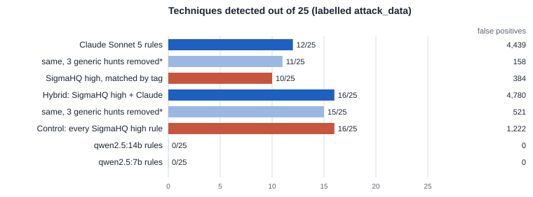

# cti-hunt — from CTI reports to verified threat hunts, and where LLMs actually help

[Tiếng Việt](README.vi.md) · [Report (PDF, 5 pages)](report/cti-hunt-report.pdf) · [Methodology](docs/METHODOLOGY.md)

A threat-hunting team reads a cyber-threat-intelligence (CTI) report and must turn its prose into hunts that run on its own
Windows logs. **cti-hunt** does this end to end — report → IOCs and ATT&CK techniques → hunt hypotheses → human review →
Sigma rules → queries → filtering and pivoting → hunt record — and is used as a test bench to answer one question:

> **At which stages does an LLM beat a method that does not use one, and at which does it not?**

Each LLM stage is measured against a non-LLM baseline (regex, BM25 retrieval, rcATT, SigmaHQ community rules) on public
datasets with event-level labels and pre-registered protocols.

## Key findings

| Question | Result |
|---|---|
| **RQ1 · Reading reports** | TTPs: Claude found **45/48** parent techniques that MITRE maps to four reports; open `qwen2.5:7b` 25/48; retrained rcATT 12/48. On a pre-registered 30-report set, the 7B model had lower recall than BM25's top suggestion (41 % vs 55 %). IOCs: a regex extractor already reaches 484/493 recall on 19 reports from 17 publishers; an LLM filter did not beat hand-written rules |
| **RQ2 · Writing detections** | On 25 randomly sampled techniques with labelled events (Splunk `attack_data`): Claude-written Sigma rules detected **12/25**, SigmaHQ high-level rules **10/25** (p = 0.75), with 4,439 vs 384 false positives. Hybrid: 16/25 (p = 0.03 vs SigmaHQ), the same as enabling every high-level SigmaHQ rule. `qwen2.5:7b` / `14b`: 0/25 |
| **RQ3 · Controls** | Static checks make Claude's rules valid (46/46), but 41 of 57 valid 14B rules never match anything due to semantic errors. A new **field-shape check** caught 34/41 of them out-of-sample with 0 false flags on 61 correct rules. A **breadth gate** caught the over-broad hunt that had inflated an earlier 17/24 scenario result (4–8/24 without it) |

**Takeaway:** use the LLM to read reports and to propose hunts for techniques that community rules do not cover; for common
techniques, select existing community rules by the report's techniques — same detection, far fewer false positives.



## How it works

```
report (HTML/PDF/image)
  ① ingest, segment, local OCR held for review
  ② extract   IOC: regex + strong/weak rules        TTP: LLM + BM25 candidates + verbatim-quote check
  ③ telemetry technique → log sources, profiled on the actual dataset
  ④ hypothesis (LLM)  →  ◆ human review (form bound to SHA-256)
  ⑤ Sigma rule (LLM) + static checks, field-shape check, breadth gate, repair fed static errors only
  ⑥ Sigma → DuckDB SQL   ⑦ reviewed exclusions, rarity ranking   ⑧ capped pivoting   ⑨ hunt record (LOCK)
        + hybrid mode: SigmaHQ rules selected by the report's techniques run in every hunt
```

- **Two modes:** a fixed pipeline, and an agent (LangGraph) whose planner chooses what to hunt, whether to pivot and when
  to stop — always under code-enforced caps and the review gate.
- **LLMs only where they are needed** (②, ④, ⑤); ingestion, telemetry mapping, execution, filtering, pivoting and the hunt
  record are deterministic code.
- **The hunting stages never see labels:** the query runner rejects label columns; the repair loop receives static
  errors only.

## Data engineering

- **Event store:** 587,286 APT29 events, 7 OTRF technique sets and 2.29 M Splunk `attack_data` events normalised into
  DuckDB / Parquet with derived keys (`ev_host`, `ev_channel`, `ev_eid`, `ev_rec`, UTC timestamps) and data-quality checks.
- **Labels from process lineage:** attack processes traced through the process tree (Sysmon GUIDs; host + PID +
  lifetime where only PIDs exist, because PIDs are reused), versioned label builders, blind audits (25/28, 30/31 out-of-sample, 9/9; 21/21 and 36/36 on OTRF).
- **Reproducibility:** every run stores hashes of inputs, prompts, configuration and code; frozen labels and benchmark
  inputs are SHA-256-pinned; protocols are hashed before labelled numbers are seen.
- **Cross-engine check:** Sigma rules translated to SPL and run on a local Splunk: 78/111 rules comparable, 0 result-set
  differences against DuckDB.
- **Cost control:** a SQLite ledger shared by all paid calls reserves the maximum cost before each call and settles from
  returned usage. Whole project: about 44 USD of API calls.

## Repository layout

```
src/cti_hunt/     stages/ (①–⑨), agent/ (LangGraph graph, sessions), adapters/ (Sigma → DuckDB), llm/ (providers, budget),
                  eval/ (metrics, statistics: Wilson, exact McNemar, sign test), hunt/, labels/, cli.py
app/              Streamlit interface, read-only MCP server for hunt records
configs/          telemetry catalogues, caps and thresholds, breadth gate, model configs
prompts/          versioned prompts (hash-pinned in run logs)
scripts/          measurement scripts that produced every reported number, label builders
eval/             pinned benchmark inputs
tests/            1,400+ tests on synthetic fixtures (no dataset or API key needed)
report/           report source, figures, PDF
docs/METHODOLOGY.md
```

Code comments, configuration keys and CLI help are in Vietnamese, the project's working language.

## Quick start

```bash
python -m venv .venv
.venv\Scripts\activate              # Windows; source .venv/bin/activate elsewhere
pip install -e ".[dev,splunk,demo]"
python -m pytest -q
```

Datasets are not redistributed. Download OTRF APT29 day 2, the OTRF technique sets, Splunk `attack_data` (commit
`aafa53e`), SigmaHQ (commit `d1c16224`) and ATT&CK Enterprise v19.2, then follow
[Methodology §6](docs/METHODOLOGY.md#6-reproducing). Paid model calls need `LLM_API_KEY`; extraction runs in dry-run mode
(prompts and cost estimate only) unless `--send` is given. The interface starts with `run_demo.bat` or
`streamlit run app/streamlit_app.py`.

## Limitations

One labelled multi-step scenario (4 hosts, 40 minutes); other datasets are single-technique lab recordings. Labels were
built by the author and checked by blind audits, not by an independent analyst. Claude's TTP extraction was measured on 4
reports and its rule generation on a random 25 of 55 eligible techniques. The human review gate was not independent of the
assistant that proposed decisions. See the [report](report/cti-hunt-report.pdf) §7.

## Author and license

Nguyễn Hoàng Duy — internship research project at VinSOC, September–October 2026.

Independent work: designed, built and evaluated by the author on public data only (OTRF, Splunk `attack_data`, SigmaHQ,
MITRE ATT&CK, public CTI reports). It uses no company data or systems and is not a VinSOC product.

Released under the [MIT License](LICENSE).
