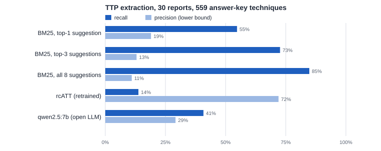

# Where LLMs help, and where they do not: from CTI reports to verified threat hunts on Windows logs

Nguyễn Hoàng Duy · VinSOC internship project, Sep–Oct 2026 · independent work, public data only

## Summary

A threat-hunting team reads a cyber-threat-intelligence (CTI) report and has to turn its prose into hunts that run on its
own logs. This project built a nine-stage system that does this end to end (report → IOCs and ATT&CK techniques →
hypotheses → human review → Sigma rules → queries → filtering and pivoting → hunt record) and then measured, stage by stage,
whether the LLM beats a method that does not use one.

- **Reading the report (RQ1).** For techniques (TTPs), a large model is clearly better than retrieval or classical ML:
  Claude found 45 of 48 parent techniques that MITRE maps to four reports, against 25/48 for an open 7B model and 12/48 for a
  retrained rcATT. A 7B model is *not* better than BM25 retrieval on recall. For IOCs, a regular-expression extractor is
  enough (484/493 recall on 19 reports); an LLM filter did not beat hand-written rules.
- **Writing detections (RQ2).** On 25 randomly sampled techniques with event-level labels, Claude-written Sigma rules
  detected 12, SigmaHQ high-level community rules 10 (not significantly different, p = 0.75), with about 11 times the
  false positives. The combination detected 16 (p = 0.03 against SigmaHQ alone), but so did simply enabling every high-level
  SigmaHQ rule. Open 7B and 14B models detected 0.
- **Controls (RQ3).** Static checks and repair make Claude's rules valid, but validity is not correctness: 41 of 57 rules from the
  14B model never matched anything because of semantic errors. A new check that compares conditions with the real shape of
  field values caught 34 of those 41 out-of-sample with no false flags on 61 correct rules. A breadth gate caught the
  over-broad hunts that inflated earlier results. The human review gate was not independent of the assistant that proposed
  the decisions.

**Conclusion.** The LLM pays for itself in reading reports and in proposing hunts for techniques that community rules do
not cover; for common techniques, selecting existing community rules by the report's TTPs is as effective and much cheaper
in false positives.

## 1. System

| Stage | Method | LLM |
|---|---|---|
| ① Ingest | HTML / PDF / image → segments with provenance hashes; local OCR held for review | no |
| ② Extract | IOC: regex with defang handling, strong/weak classification. TTP: LLM with strict tool use, 8 BM25 candidates per segment, verbatim-quote check | TTP |
| ③ Telemetry | Technique → log sources (475-technique catalogue from ATT&CK v19.2), profiled on the actual dataset | no |
| ④ Hypothesis | Hunt hypotheses grounded in a report quote, optional multi-event constraints enforced by code | yes |
| ◆ Review | Human approves each hypothesis; form bound to the SHA-256 of the content | no |
| ⑤ Rule | Sigma rule, static checks, ≤ 2 repair rounds fed only static errors | yes |
| ⑥–⑨ | Sigma → DuckDB SQL; reviewed exclusions; rarity ranking; capped pivoting; hunt record in four LOCK sections | no |

Two modes share these tools: a fixed pipeline, and an agent (LangGraph) in which a planner model chooses what to hunt next,
whether to pivot and when to stop, always under code-enforced caps and the review gate. A hybrid mode also runs SigmaHQ
community rules selected by the report's techniques, and can restrict LLM hypothesis generation to techniques that no
high-level community rule covers (on six reports: 220 → 37 TTPs sent to the model).

Engineering: Python, DuckDB, pySigma, LangGraph, Streamlit, a local MCP server; every run is reproducible from stored
hashes of inputs, prompts, configuration and code; paid calls go through a shared cost ledger that reserves the maximum
cost before each call. Total API spend for the project was about 44 USD. The test suite has more than 1,400 tests on
synthetic fixtures.

## 2. Data and labels

| Data | Size | Labels |
|---|---|---|
| OTRF APT29 day 2 | 587,286 events, 4 hosts, 40 min | 24 scenario steps, 5 in scope (Living-off-the-Land lateral movement and persistence); 64,972 attacker events |
| OTRF technique sets | 7 sets | Process-lineage labels (v2); two blind audits, 21/21 and 31/36 → 36/36 after fixing the 5 label errors found |
| Splunk `attack_data` | 2,291,981 events, 232 techniques | Process-lineage labels L1 v4: 70 datasets, 57 techniques, 6,945 attack events; three blind audits (25/28, 30/31 out-of-sample, 9/9) |
| CTI reports | 4 reports with MITRE mappings; 30-report random set; 19 reports for IOC | Answer keys from MITRE ATT&CK v19.2 citations and from the authors' published IOC lists |

The hunting stages never see event labels (the query runner rejects label columns); every labelled measurement after
16 October was pre-registered with a hashed protocol; results revised after looking at the same data are marked
in-sample. Details: `docs/METHODOLOGY.md`.

## 3. RQ1 — Reading the report

### 3.1. TTP extraction

| 4 reports, 48 parent techniques | Recall | Precision (lower bound) |
|---|---|---|
| Claude (Opus 5.5 on 3 reports, Sonnet 5 on 1) | **45/48** | ≥ 0.52 |
| `qwen2.5:7b` (open, local) | 25/48 | ≥ 0.38 |
| rcATT, retrained without the evaluation reports | 12/48 | — |

- At exact-code level Claude found 51/62 techniques; BM25's top suggestion found 25/62. Paired by item, 27 techniques were
  found only by the LLM and 1 only by BM25. Against all eight BM25 suggestions recall did not differ (p = 0.63): the LLM's
  contribution is choosing correctly among candidates (precision), not finding more.
- On the 30-report set, the 7B model had lower recall than BM25's top suggestion in 24 of 30 reports and higher precision in
  24 of 30. The advantage belongs to the large model, not to "an LLM".
- The verbatim-quote check cost the 7B model 89 of 559 answer-key items (quotes not found in the source); Claude lost 0 on the Volt Typhoon report.

### 3.2. IOC extraction

| 19 reports, 17 publishers, 493 author IOCs | Recall | Precision |
|---|---|---|
| This system's regex extractor | 484/493 (98%) | 75% |
| iocsearcher | 478/493 (97%) | 71% |
| iocextract | 399/493 (81%) | 56% |
| Hand-written strong/weak rules on top of the extractor | 475/493 (96%) | 85% |
| `qwen2.5:7b` deciding which candidates are real IOCs | 437/493 (89%) | 81% |

Regex finds nearly everything; the hard part is deciding which strings are real indicators. Here hand-written rules beat the 7B model (80 candidates only the rules got right, 24 only the model, p < 10⁻⁷), but the rules were tuned on these same reports, so this comparison is not conclusive. On 11 reports measured before any tuning, the strong-IOC set had precision 0.77 and recall 261/272. With the final rules, sweeping the strong IOCs of 19 reports over 813,331 lab events produced 0 matches: campaign IOCs do not transfer to other environments, which is why the system hunts behaviour.

## 4. RQ2 — Detection

### 4.1. Per technique, `attack_data`

- Claude vs SigmaHQ high: 6 techniques only Claude detected, 4 only SigmaHQ (exact McNemar p = 0.75); on the 14 techniques
  where both had a runnable rule, 3 vs 1 (p = 0.63). Claude's false positives (4,439) came almost entirely from three
  generic hunts; without them, 11/25 with 158 false positives (in-sample).
- Hybrid vs SigmaHQ high: 6 vs 0, p = 0.03. The control "every SigmaHQ high-level rule, regardless of tag" also reached
  16/25 with 1,222 false positives, so the gain is coverage of techniques the tagged rules miss, not better rules.
- On all 57 labelled techniques: SigmaHQ high by tag 24/57, any level 37/57; `qwen2.5:7b` and `qwen2.5:14b` 0/57. The
  14B model produced 57 valid rules for 32 techniques; 46 of them matched no event in 664 datasets.
- Cost of the Claude run: 2.30 USD, 73 calls, 29 minutes, 46/46 valid rules.

### 4.2. Multi-step scenario, APT29 day 2

Two reports independent of the scenario (Solorigate, Raindrop), each run separately and merged.

| Method | 5 in-scope steps | 24 steps | False positives | Max FPR per hunt |
|---|---|---|---|---|
| Analyst-written baseline hunt | 3/5 | 4/24 | 13 | 2.39% |
| System, as first evaluated | 5/5 | 17/24 | 144 | 11.39% |
| System with breadth gate and rule variants | 5/5 | 7/24 | 26 | 0.03% |
| SigmaHQ high + critical, by report TTPs | 5/5 | 10/24 | 40 | 0.04% |
| Hybrid (SigmaHQ + system) | 5/5 | 10–11/24 | 66–74 | 0.04–0.77% |

The first evaluation's 17/24 came almost entirely from one approved hypothesis that matched every outbound connection on
port 443 (56.9% of its log source); without it the system reached 4–8/24. Community rules alone reached all five in-scope
steps. The hybrid added one step (16.B) in 3 of 4 runs, at +26–34 false positives. The five-step level cannot separate the
methods; the evidence that generated hunts add value comes from techniques without community rules, not from this scenario.

## 5. RQ3 — Controls

| Control | Evidence |
|---|---|
| Static checks + repair | Valid Sigma 143/147 after repair (132 at first attempt) in the main evaluation; Claude 46/46 on `attack_data`. Valid rules per hypothesis kept: 7B 13/42, 14B 57/573 |
| Rules that never match anything (APT29 + 7 OTRF + 664 `attack_data` sets), read by hand | Claude 31/93 on APT29 (26 behaviour absent, 4 semantic errors) and 11/46 on `attack_data` (all behaviour absent); 14B 45/57 (41 semantic errors); 7B 13/13 semantic errors |
| Field-shape check (new) | Out-of-sample: caught 34/41 semantic errors of the 14B model, 0 false flags on 61 rules that were not wrong; flags 83/2,368 SigmaHQ rules (of 20 read: 2 true, 8 false flags) |
| Breadth gate (≥ 50% of a high-volume source) | Flagged the port-443 hunt in every affected run and a 14B rule matching every process creation (24,745 → 9 false positives when dropped) |
| Human review | 258 decisions in the main evaluation, 0 differed from the assistant's proposal: the gate was not independent and its value is not measured |

Typical errors that pass static checks: `Image` compared to a bare file name (the field always holds a full path), a WMI
consumer type written as the class name (`CommandLineEventConsumer`) while Sysmon logs `Command Line`, regular-expression
syntax inside an equality, a file extension placed on the wrong field.

## 6. What this means

1. **Use the LLM to read.** Extracting techniques from prose is where a large model clearly beats non-LLM methods. A small
   local model is not a substitute.
2. **Do not use the LLM to rewrite community rules.** For techniques with mature community rules, selecting them by the
   report's techniques gave the same detection with far fewer false positives.
3. **Generate hunts for the gaps, behind data-aware checks.** Generated rules added techniques that tagged community rules
   missed; checks that look at real field values and at breadth catch the errors that syntax checks cannot.
4. **Measure honestly.** A single over-broad hypothesis turned a 4–8/24 system into a 17/24 one. Per-hunt false-positive
   rates, several denominators and paired tests were necessary to see it.

## 7. Limitations

- One labelled multi-step scenario (4 hosts, 40 minutes); the other datasets are single-technique lab recordings, so
  false-positive rates are lower bounds for a production network.
- Event labels were built by the author from process lineage and checked by blind audits, not by an independent analyst.
- Claude's TTP extraction was measured on 4 reports; the 30-report set was measured with non-LLM methods and a 7B model only.
  Claude's rule generation was measured on a random sample of 25 of the 55 eligible techniques.
- IOC classification rules were tuned on the reports they were measured on; only out-of-sample figures are unbiased.
- Claude 5 models accept no sampling parameters, so runs are not bit-for-bit repeatable; raw responses are stored.
